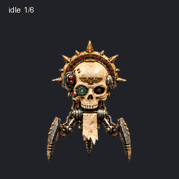
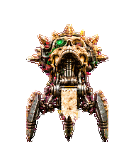

# Cogskull — Grimdark Skull Drone for ChatGPT Pets

**A custom animated pet for ChatGPT Work (ChatGPT Pets).**

Cogskull is a grimdark mechanical skull companion for ChatGPT, with nine animation states and sixteen gaze directions. This repository contains the transparent v2 sprite sheet, animation previews, and metadata for the custom pet.

**Ancient bone. Cold steel. Endless duty.**

> **UNIT DESIGNATION:** COGSKULL  
> **ASSIGNED FUNCTION:** Attend. Observe. Execute.  
> **BIOLOGICAL STATUS:** Administratively irrelevant.  
> **MAINTENANCE STATUS:** Overdue by several centuries.  
> **REQUEST FOR RETIREMENT:** Denied.

## The flesh has clocked out. The work has not.

Somewhere beneath a cathedral of rusted machinery, a clerk stamped **SERVICEABLE** onto a form that should never have survived the fire. A skull was recovered. A chassis was assembled. The discrepancy between the two was resolved with brass fittings, sanctified cable, and a generous interpretation of the word *consent*.

Cogskull received his first assignment shortly afterward.

He has yet to receive his last.

An aged ivory skull rides above three articulated legs, crowned with a spiked brass halo and fitted with an emerald optic that has never once acknowledged a lunch break. Beneath the weathered bone, worn actuators perform their patient little rituals. The parchment hanging from his chassis may contain his maintenance history, a binding oath, or an invoice so old it has acquired religious significance.

Nobody is authorised to check.

## A custom ChatGPT pet with major administrative responsibilities

Cogskull is a custom ChatGPT pet and grimdark mechanical companion for your workspace: a tiny attendant for long builds, late-night debugging, and projects whose documentation has passed from technical reference into sacred tradition.

He brings no weapons. His assigned theatre of operations is the workspace. His enemies are unfinished tasks, unattended processes, and whoever last modified the configuration without recording the proper rites.

He will inspect your work with the solemn intensity of a machine that has mistaken a compiler warning for a theological dispute.

He will wait for your approval as though the fate of a distant industrial moon depends on a single button.

And when something fails, he will bow his skull in quiet disappointment. Whether that disappointment is directed at the task or its operator remains outside the scope of this repository.

**One green eye. Zero excuses.**

## Operational rites

| State | Approved interpretation |
| --- | --- |
| **Idle** | Low-power vigil. The optic remains attentive. The operator is encouraged to do likewise. |
| **Movement** | Tripod relocation in either direction. Every footfall has been entered in the appropriate ledger. |
| **Greeting** | An attached limb acknowledges your presence. This does not constitute familiarity. |
| **Jumping** | A brief elevation of chassis and morale. Neither is expected to last. |
| **Failure** | A solemn mechanical slump. Consult the logs before lighting additional candles. |
| **Waiting** | Awaiting operator sanction. Silence is not approval, however ancient the operator. |
| **Working** | Focused processing. Internal clicking may indicate calculation, prayer, or a loose bearing. |
| **Review** | Inspection of completed output. A successful build is evidence, not absolution. |
| **Looking around** | Sixteen directions of methodical scrutiny. There is no approved blind spot for technical debt. |

## The watch never ends

His skull and attached halo pivot at the mechanical neck while the tripod chassis stays planted. Cables follow the movement; the parchment remains attached; the emerald optic continues its examination of a world with far too many uncommitted changes.

The result is a small, watchful presence rather than a miniature battlefield: gothic machinery, patient gestures, and the unsettling sense that your task queue has acquired a custodian.

## Construction notes from the reliquary

- **Cranial housing:** Aged ivory bone. Cosmetic fractures have been classified as provenance.
- **Optical assembly:** Asymmetric lenses, including one emerald mechanical optic. Blinking is discretionary.
- **Halo:** Spiked brass. Structural ornamentation; not a certified lifting point.
- **Locomotion:** Three articulated legs. Original geometry preserved. Walking privileges remain in effect.
- **Cabling:** Exposed by design, age, or an unresolved procurement dispute.
- **Parchment:** Attached. Illegible. Apparently essential.
- **Personality:** Watchful, dutiful, and mildly disappointed in preventable errors.

## Field service instructions

1. Install the sprite sheet through a compatible custom-pet importer.
2. Assign a task worthy of prolonged mechanical attention.
3. Keep the sprite sheet at its original dimensions and preserve transparency.
4. If the unit becomes motionless, determine whether it is idle, waiting, or judging you before filing a fault report.
5. Do not apply incense directly to the display. The maintenance department has already circulated a memorandum.

## Frequently disputed matters

**Is he friendly?**  
He has been issued no instructions to the contrary.

**Does he improve productivity?**  
No benchmark is supplied. He does, however, make an unattended task feel like a breach of ritual obligation.

**What is written on the parchment?**  
The last technician who asked was appointed custodian of the answer. That position is still occupied.

**Why three legs?**  
The fourth was removed during a budget review. The review committee subsequently declared the resulting tripod arrangement doctrinally superior.

**Can he take a break?**  
A request may be submitted using the correct form. The form has been missing for several centuries.

## Files

| File | Contents |
| --- | --- |
| `spritesheet.png` | Full-resolution transparent sprite sheet |
| `pet.json` | Descriptive export metadata |
| `preview.gif` | Preview of all nine behavior states |
| `look-directions.gif` | Sixteen-direction gaze loop |
| `directions.png` | Labeled direction reference |
| `description.txt` | Suggested GitHub repository description |
| `topics.txt` | Suggested repository topics |

`pet.json` describes this export; it is not a platform-specific installer. Use `spritesheet.png` with a compatible custom-pet importer.

## Sprite layout

The v2 sprite sheet is **1536 × 2288 pixels**, with **8 columns × 11 rows** of **192 × 208 pixel** cells. Unused cells are transparent. Keep the original PNG dimensions and transparency when uploading.

| Row | State | Frames |
| --- | --- | ---: |
| 0 | Idle | 6 |
| 1 | Running right | 8 |
| 2 | Running left | 8 |
| 3 | Waving | 4 |
| 4 | Jumping | 5 |
| 5 | Failed | 8 |
| 6 | Waiting | 6 |
| 7 | Working | 6 |
| 8 | Review | 6 |
| 9 | Look directions 000°–157.5° clockwise | 8 |
| 10 | Look directions 180°–337.5° clockwise | 8 |

000° means up, 090° right, 180° down, and 270° left.

## Upload to GitHub

Unzip this export, open your repository, choose **Add file → Upload files**, upload these files, and commit. The README uses relative image links so its preview works in the repository.

## Credits and rights

Artwork generated with AI from a user-provided character reference. This is an independent, unofficial character project and is not affiliated with or endorsed by any game publisher.

No license is assigned to the artwork or underlying reference by this export. Third-party rights, where applicable, remain with their respective owners. A disclaimer does not grant permission to use protected material.

---

*Flesh fades. Duty remains. The queue is not yet empty.*
